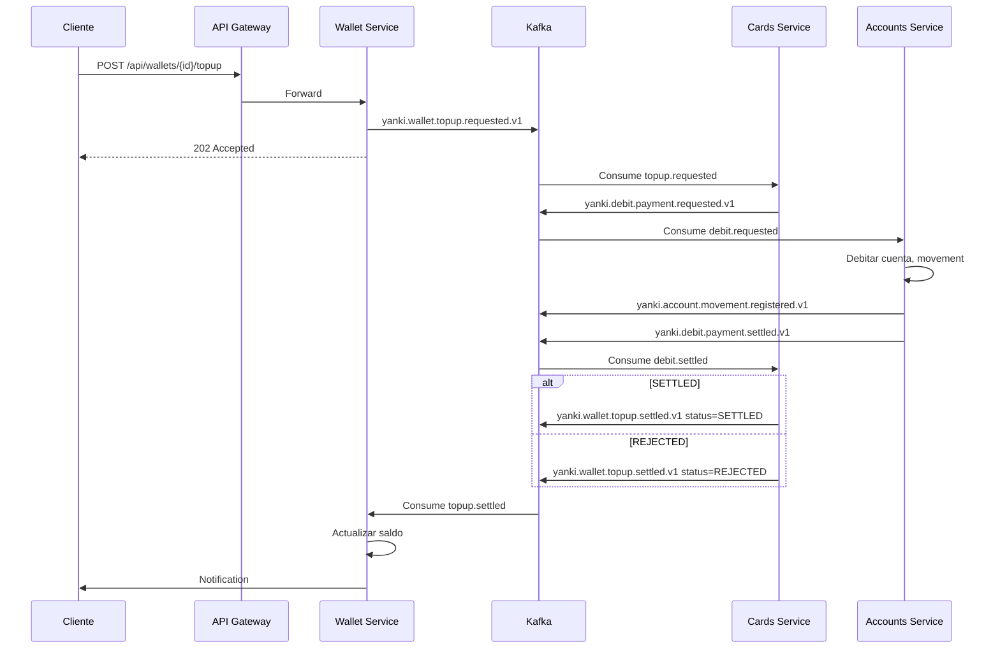

# wallet-service

Microservicio de **monedero móvil Yanki** de la plataforma bancaria **Yanki**.

Implementa la funcionalidad nativa event-driven de la **Parte III**: monedero móvil con top-up, P2P, retiro y asociación a tarjeta débito.

- **Puerto:** `8087`
- **Base de datos propia:** MongoDB `yanki_wallet` (colecciones: `wallets`, `transactions`, `customer_profile_view`, `customer_risk_view`)
- **Cache:** Redis (saldos wallet TTL 5m, teléfono→walletId TTL 24h)
- **Stack:** Java 17, Spring Boot 3.3.5, Spring WebFlux, Spring Data Reactive (MongoDB + Redis), RxJava 3, Spring Kafka, springdoc-openapi
- **Estado:** 🟢 Implementado (Arquitectura Hexagonal completa)

---

## 0. Arquitectura Hexagonal

El servicio sigue estrictamente la **Arquitectura Hexagonal** (Puertos y Adaptadores) según `system-prompt-auditoria-hexagonal-yanki.md`.

### Estructura de paquetes

```
com.yanki.wallet
├── domain/                    # NÚCLEO PURO (sin dependencias de infraestructura)
│   ├── model/                 # Entidades: Wallet, Transaction, CustomerRiskView
│   ├── exception/             # BusinessException, ErrorCodes
│   ├── event/                 # Eventos Kafka: WalletOpenedEvent, WalletTransactionEvent, etc.
│   ├── port/
│   │   ├── in/                # Puertos de entrada (casos de uso): OpenWalletUseCase, TopUpWalletUseCase, etc.
│   │   └── out/               # Puertos de salida: WalletPersistencePort, EventPublisherPort, etc.
│   └── service/               # WalletService (implementa todos los casos de uso)
├── infrastructure/            # ADAPTADORES SECUNDARIOS
│   ├── persistence/           # MongoDB: documentos, repositorios, mappers, adaptadores
│   ├── messaging/             # Kafka: publisher adapter, consumers
│   └── cache/                 # Redis: cache adapter
└── interfaces/                # ADAPTADORES PRIMARIOS
    └── rest/                  # REST: controller, DTOs, mapper, GlobalExceptionHandler
```

### Reglas verificadas

| Regla | Estado |
|-------|--------|
| `domain` no importa `infrastructure` ni `interfaces` | ✅ |
| Sin `.block()`, `.blockingGet()`, `.blockingFirst()` en dominio | ✅ |
| Entidades puras sin `@Document`/`@Id` | ✅ |
| `domain.service` no importa Spring Data/Kafka/Web | ✅ |
| Controladores inyectan puertos, no repositorios | ✅ |
| Javadoc en español | ✅ |
| Montos en `BigDecimal` | ✅ |
| Consumidores Kafka con idempotencia (`processed_events`) | ✅ |

### Casos de uso implementados

| Caso de Uso | Puerto de Entrada | Descripción |
|-------------|-------------------|-------------|
| Apertura wallet | `OpenWalletUseCase` | Verifica unicidad + riesgo, crea wallet, publica evento |
| Top-up | `TopUpWalletUseCase` | Requiere tarjeta débito, crea transacción PENDING, publica evento |
| P2P | `SendP2PUseCase` | Busca destinatario por teléfono, debita al emisor |
| Retiro | `WithdrawWalletUseCase` | Debita wallet, crea transacción, publica evento |
| Asociar tarjeta | `AssociateCardUseCase` | Vincula tarjeta débito a wallet |
| Desasociar tarjeta | `DisassociateCardUseCase` | Remueve tarjeta débito de wallet |
| Consulta | `GetWalletUseCase` | findById, findByPhoneNumber, getTransactions |

---

## 1. Propósito

| Responsabilidad | Detalle |
|---|---|
| Apertura wallet | Registro con customerId válido (un wallet por cliente) |
| Top-up | Carga desde tarjeta débito → solicita a cards-service → liquida |
| P2P | Envío/recepción entre wallets Yanki (por teléfono) |
| Retiro | Extracción a cuenta bancaria (transferencia a accounts) |
| Asociación débito | Vincular tarjeta débito para top-ups rápidos |
| Reglas | Bloqueo si deuda vencida, un wallet por cliente, top-up solo con débito válido |

---

## 2. Endpoints REST

Base: `/api/wallets`

| Método | Ruta | Descripción | Respuesta |
|---|---|---|---|
| `POST` | `/api/wallets` | Abrir wallet (requiere customerId válido) | `201` `WalletResponse` |
| `GET` | `/api/wallets/{id}` | Detalle wallet + saldo | `200` `WalletResponse` |
| `GET` | `/api/wallets/phone/{phone}` | Buscar wallet por teléfono (P2P) | `200` `WalletResponse` |
| `POST` | `/api/wallets/{id}/topup` | Solicitar top-up (debitCardId, amount) | `202` `TopUpResponse` |
| `POST` | `/api/wallets/{id}/send` | Enviar dinero (counterpartyPhone, amount) | `202` `TransactionResponse` |
| `POST` | `/api/wallets/{id}/withdraw` | Retirar a cuenta bancaria (accountId, amount) | `202` `TransactionResponse` |
| `POST` | `/api/wallets/{id}/associate-card` | Asociar tarjeta débito (cardId) | `200` `WalletResponse` |
| `POST` | `/api/wallets/{id}/disassociate-card` | Desasociar tarjeta débito | `200` `WalletResponse` |
| `GET` | `/api/wallets` | Listar todas las wallets (paginado) | `200` `WalletPageResponse` |
| `GET` | `/api/wallets/{id}/transactions` | Historial transacciones | `200` `Flux<TransactionResponse>` |

### 2.1 Ejemplos

```bash
# Apertura wallet
curl -X POST http://localhost:8087/api/wallets \
  -H "Content-Type: application/json" \
  -H "Authorization: Bearer <token>" \
  -d '{"customerId": "CUST-123"}'

# Top-up desde tarjeta débito
curl -X POST http://localhost:8087/api/wallets/WALLET-123/topup \
  -H "Content-Type: application/json" \
  -d '{"debitCardId": "CARD-456", "amount": 200}'

# Envío P2P (por teléfono)
curl -X POST http://localhost:8087/api/wallets/WALLET-123/send \
  -H "Content-Type: application/json" \
  -d '{"counterpartyPhone": "+51987654321", "amount": 50}'

# Retiro a cuenta bancaria
curl -X POST http://localhost:8087/api/wallets/WALLET-123/withdraw \
  -H "Content-Type: application/json" \
  -d '{"accountId": "ACC-123", "amount": 100}'

# Asociación tarjeta débito
curl -X POST http://localhost:8087/api/wallets/WALLET-123/associate-card \
  -H "Content-Type: application/json" \
  -d '{"cardId": "CARD-789"}'

# Desasociación tarjeta débito
curl -X POST http://localhost:8087/api/wallets/WALLET-123/disassociate-card \
  -H "Authorization: Bearer <token>"
```

### 2.2 Errores

| Código | HTTP | Causa |
|---|---|---|
| `WALLET_NOT_FOUND` | 404 | Wallet no existe |
| `WALLET_ALREADY_EXISTS` | 409 | Cliente ya tiene wallet |
| `WALLET_INACTIVE` | 400 | Wallet no está activa para operar |
| `WALLET_BLOCKED_RISK` | 403 | Deuda vencida (risk view) |
| `CUSTOMER_HAS_OVERDUE_DEBT` | 403 | Cliente tiene deuda vencida |
| `INSUFFICIENT_BALANCE` | 400 | Saldo insuficiente para enviar/retirar |
| `INVALID_AMOUNT` | 400 | Monto inválido (nulo o ≤ 0) |
| `RECIPIENT_NOT_FOUND` | 404 | Teléfono destino sin wallet |
| `CANNOT_SEND_TO_SELF` | 400 | Intento de envío a la misma wallet |
| `DEBIT_CARD_REQUIRED` | 400 | Se requiere tarjeta débito asociada para top-up |
| `CARD_ALREADY_ASSOCIATED` | 409 | La tarjeta ya está asociada |
| `NO_CARD_ASSOCIATED` | 400 | No hay tarjeta asociada para desasociar |
| `VALIDATION_ERROR` | 400 | Error de validación general |
| `P2P_DAILY_LIMIT_EXCEEDED` | 400 | Límite P2P diario superado |
| `WALLET_LIMIT_EXCEEDED` | 400 | Límite de wallet excedido |
| `INVALID_DEBIT_CARD` | 400 | Tarjeta débito inválida |

---

## 3. Reglas de Negocio

### 3.1 Restricciones

| Regla | Descripción |
|---|---|
| **Un wallet por cliente** | `customerId` único en colección `wallets` |
| **Top-up solo con débito** | Requiere tarjeta débito válida asociada |
| **Bloqueo por deuda** | Si `customer_risk_view.hasOverdueDebt = true` → bloquea operaciones |
| **P2P por teléfono** | Solo entre wallets Yanki (búsqueda por teléfono) |
| **Retiro a cuenta** | Requiere cuenta bancaria válida del mismo cliente |

### 3.2 Top-up (Flujo Bidireccional Wallet ↔ Cards ↔ Accounts)



---

## 4. Eventos Kafka

### 4.1 Publicados (Outbound)

| Topic | Key | Payload | Trigger |
|---|---|---|---|
| `yanki.wallet.opened.v1` | `walletId` | `WalletOpenedEvent` | Apertura exitosa |
| `yanki.wallet.transaction.registered.v1` | `walletId` | `WalletTransactionRegisteredEvent` | Cada transacción (TOPUP/SEND/RECEIVE/WITHDRAWAL) |
| `yanki.wallet.topup.requested.v1` | `requestId` | `WalletTopUpRequestedEvent` | POST `/topup` |

### 4.2 Consumidos (Inbound)

| Topic | Propósito | Acción |
|---|---|---|
| `yanki.wallet.topup.settled.v1` | Respuesta top-up | Confirmar/rechazar carga saldo |
| `yanki.customer.registered.v1` | Nuevo cliente | Crear `customer_profile_view` |
| `yanki.customer.updated.v1` | Cambio perfil/estado | Actualizar `customer_profile_view` |
| `yanki.customer.deleted.v1` | Cliente eliminado | Marcar vistas DELETED |
| `yanki.credit.overdue.v1` | Deuda vencida | Actualizar `customer_risk_view` (bloqueo) |
| `yanki.card.opened/closed.v1` | Tarjeta débito | Validar tarjeta para top-up |

---

## 5. Modelo de Datos

### Wallet (`wallets`)

```java
// Entidad pura de dominio (sin anotaciones de infraestructura)
public class Wallet {
    String id;
    String customerId;
    String phoneNumber;               // Para P2P
    String imei;                      // IMEI del dispositivo
    BigDecimal balance;
    WalletStatus status;              // ACTIVE | BLOCKED | CLOSED
    String associatedDebitCardId;     // Tarjeta débito para top-up
    LocalDateTime createdAt;
    LocalDateTime updatedAt;
}
```

### Transacción (`transactions`)

```java
// Entidad pura de dominio (sin anotaciones de infraestructura)
public class Transaction {
    String id;
    String walletId;
    TransactionType type;             // TOPUP | SEND | RECEIVE | WITHDRAWAL
    BigDecimal amount;
    BigDecimal balanceAfter;
    TransactionStatus status;         // PENDING | COMPLETED | REJECTED
    String counterpartyPhone;         // Para SEND/RECEIVE
    String counterpartyWalletId;
    String referenceId;               // Para top-up/withdrawal
    String description;               // Descripción de la transacción
    LocalDateTime occurredAt;
    LocalDateTime createdAt;
}
```

---

## 6. Redis Cache

| Clave | Contenido | TTL | Invalidación |
|---|---|---|---|
| `yanki:wallet:balance:{walletId}` | Saldo wallet | 5m | Cada transacción |
| `yanki:wallet:phone:{phone}` | Teléfono → walletId | 24h | Actualización phone |

---

## 7. Variables de Entorno

| Variable | Default | Descripción |
|---|---|---|
| `SERVER_PORT` | `8087` | Puerto HTTP |
| `MONGODB_URI` | `mongodb://localhost:27017/yanki_wallet` | URI MongoDB |
| `REDIS_HOST` | `localhost` | Host Redis |
| `REDIS_PORT` | `6379` | Puerto Redis |
| `KAFKA_BOOTSTRAP_SERVERS` | `localhost:9092` | Brokers Kafka |
| `KAFKA_GROUP_ID` | `wallet-service` | Consumer group |
| `EUREKA_URL` | `http://localhost:8761/eureka/` | Service discovery |
| `CONFIG_SERVER_URL` | `http://localhost:8888` | Config Server |

---

## 7. Cómo Ejecutarlo

### 7.1 Desarrollo
```powershell
$env:JAVA_HOME="C:\Program Files\Java\jdk-17.0.21.0.3"
$env:PATH="$env:JAVA_HOME\bin;$env:PATH"
mvn spring-boot:run
```

### 7.2 Build y Pruebas
```powershell
$env:JAVA_HOME="C:\Program Files\Java\jdk-17.0.21.0.3"
$env:PATH="$env:JAVA_HOME\bin;$env:PATH"
mvn clean verify
```

### 7.3 Docker
```bash
docker build -t yanki/wallet-service:1.0.0 .
docker run -p 8087:8087 \
  -e MONGODB_URI=mongodb://host.docker.internal:27017/yanki_wallet \
  -e REDIS_HOST=host.docker.internal \
  -e KAFKA_BOOTSTRAP_SERVERS=host.docker.internal:9092 \
  yanki/wallet-service:1.0.0
```

### 7.3 Salud
```bash
curl http://localhost:8087/actuator/health
```

---

## 8. Estructura del Código

```
src/main/java/com/yanki/wallet
├── WalletServiceApplication.java
├── domain
│   ├── model          # Wallet, Transaction, enums, vistas
│   ├── repository     # WalletRepository, TransactionRepository, vistas
│   ├── service        # WalletService, TopUpService, P2PService, WithdrawalService
│   ├── event          # Eventos Kafka
│   └── exception      # BusinessException, ErrorCodes
├── infrastructure
│   ├── config         # OpenApiConfig, ResilienceConfig, RedisConfig
│   ├── persistence    # Mappers, Custom Repositories
│   └── messaging      # WalletEventPublisher, WalletEventConsumer
└── interfaces
    └── rest
        ├── controller # WalletController
        ├── dto        # Request/Response
        └── GlobalExceptionHandler.java
```

---

## 9. Trazabilidad y Documentación

### Casos de Uso relacionados

| CU | Nombre | SECs | CPs |
|----|--------|------|-----|
| **CU-17** | Gestión Wallet | SEC015–SEC020, SEC034 | CP-150 a CP-165 (6 HP + 10 Error) |
| **CU-20** | Flujo Integral Wallet | SEC015–SEC020 | CP-186, CP-187 (1 HP + 1 Error) |

### Diagramas de Secuencia

| Diagrama | Flujo |
|----------|-------|
| [SEC015](../DIAGRAMAS_SECUENCIAS/SEC015_apertura_wallet.md) | Apertura wallet |
| [SEC016](../DIAGRAMAS_SECUENCIAS/SEC016_topup_wallet.md) | Top-up wallet |
| [SEC017](../DIAGRAMAS_SECUENCIAS/SEC017_pago_p2p_wallet.md) | Pago P2P entre wallets |
| [SEC018](../DIAGRAMAS_SECUENCIAS/SEC018_retiro_wallet.md) | Retiro wallet a cuenta |
| [SEC019](../DIAGRAMAS_SECUENCIAS/SEC019_asociacion_tarjeta_wallet.md) | Asociación tarjeta débito |
| [SEC020](../DIAGRAMAS_SECUENCIAS/SEC020_desasociacion_tarjeta_wallet.md) | Desasociación tarjeta débito |
| [SEC028](../DIAGRAMAS_SECUENCIAS/SEC028_job_mora_bloqueo_transversal.md) | Bloqueo por deuda vencida (transversal) |
| [SEC034](../DIAGRAMAS_SECUENCIAS/SEC034_topup_wallet_tripartito.md) | Top-up tripartito (Wallet→Cards→Accounts) |

### Casos de Prueba

Los casos de prueba detallados (18 casos: 7 Happy Path + 11 Error) se encuentran en:

- **[test-cases/CASOS_PRUEBA_WALLET.md](test-cases/CASOS_PRUEBA_WALLET.md)** — Casos de prueba completos con precondiciones, pasos y validaciones.
- **[test-cases/README.md](test-cases/README.md)** — Índice y resumen de cobertura por funcionalidad.

### Referencias

| Archivo | Sección | Descripción |
|---------|---------|-------------|
| `../Proyecto General vf.md` | Parte III § Wallet Yanki | Requisitos base del monedero móvil |
| `../README.md` | Arquitectura global | Mapa de microservicios, flujos bidireccionales, vistas locales |
| `AGENTS.md` (este servicio) | Especificación técnica | Stack, protocolos, deployment, observabilidad, runbook |
| `../docs/CASOS_PRUEBA` | CU-17, CU-20 | Fuente original de los casos de prueba |
| `../docs/CASOS_PRUEBA` | Fila CU-17, CU-20 | Matriz de trazabilidad completa |
| `../docs/CASOS_PRUEBA` | Sección 7 | Mapeo wallet-service ↔ CU ↔ SEC ↔ CP |
| `../docs/EVENTOS.md` | Catálogo topics Kafka | wallet.*, debit.payment, card.* |
| `../docker-compose.full.yml` | Infraestructura | Servicios y dependencias |
| `../init-mongo-parte1.js` | Datos de prueba | Vistas locales y seed data |
| `api/wallet-service.yaml` | Contrato OpenAPI 3.0 | Especificación completa con schemas, endpoints y errores |